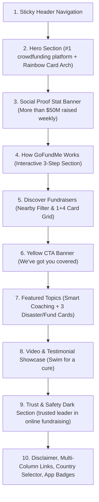

# GoFundMe Page Topology & Section Architecture

Target URL: `https://www.gofundme.com/`

## Section Order & Layout Hierarchy

## Component Breakdown

1. `Header`: `src/components/Header.tsx` (Search, NavLinks, GoFundMe Logo, Notification badge, Sign In, Start a GoFundMe)
2. `Hero`: `src/components/Hero.tsx` (Headline, subtitle, CTA button, Tilted 5-card arch)
3. `StatsBanner`: `src/components/StatsBanner.tsx` ("No fee to start fundraising", "$50 million raised weekly")
4. `HowItWorks`: `src/components/HowItWorks.tsx` (3 steps with active indicators and floating social icons preview)
5. `DiscoverFundraisers`: `src/components/DiscoverFundraisers.tsx` (Nearby dropdown, left/right carousel arrows, 1 large card + 4 grid cards with progress bars)
6. `YellowBanner`: `src/components/YellowBanner.tsx` ("We've got you covered.", category anchor links)
7. `FeaturedTopics`: `src/components/FeaturedTopics.tsx` (Smart coaching card + Giving Funds, Washington Wildfire, Venezuela Earthquakes)
8. `VideoSection`: `src/components/VideoSection.tsx` (Sage green curved banner, video player mock with controls)
9. `TrustSafety`: `src/components/TrustSafety.tsx` (Dark forest green banner with disaster relief volunteers image)
10. `Footer`: `src/components/Footer.tsx` (4 link columns, country picker, legal links, store download badges)
